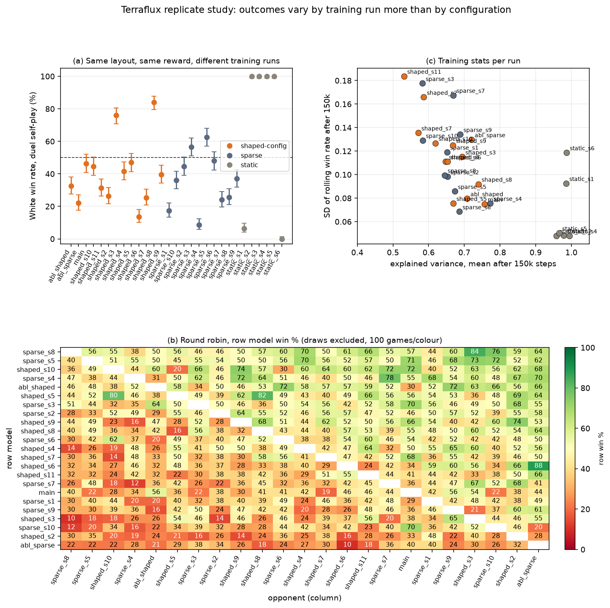

# Terraflux · 涌陆

[](https://doi.org/10.5281/zenodo.16898141)

**A pursuit-evasion board game on a self-modifying board — and a reinforcement-learning study of what "fair rules" even mean.**
*(formerly "Terrain Chess")*

Every move rewrites the terrain under the pieces: pillars rise, sink, and fill in.
The pursuer (black) can only capture from a height advantage, so the whole game is a fight
over the *shape of the board itself*. This repo contains a playable 3D simulator (Three.js),
three kinds of agents (heuristic / PPO self-play / LLM), and a set of experiments on
rule fairness, reward shaping, and self-play training dynamics.

## Research status (v2 — corrected)

> The first version of the study had a **reward bug**: the training environment hard-coded the step penalty, so the "sparse" arm of the reward-shaping ablation was trained with the same penalty as the "shaped" arm. Conclusions drawn from that comparison are withdrawn. Replicate runs (seeds recorded) show that outcomes vary more across training runs than across the configurations compared. See **[report/REPORT.md](report/REPORT.md)** (v2) for the full revision note; the superseded v1 text is kept in `report/REPORT_v1_superseded.md`.

What the replicates currently support:

1. **Training is noisy.** Rolling win rates oscillate in every dynamic-terrain run, and the value function's explained variance plateaus well below 1. A static-board control does not isolate the cause, because freezing the terrain changes the game's balance.
2. **Step-penalty effect not established.** Ten sparse and thirteen penalised runs do not differ significantly in learning speed (p ≈ 0.43) or in late-stage win rate against each run's own pool (p ≈ 0.34).
3. **Duel balance is not certifiable from one policy.** The White win rate across runs with identical settings ranges from 9% to 84%; round-robin strength is only weakly related to it (Spearman ρ = 0.23, twenty-three runs).



Scripts: `python/run_robustness.ps1` (training batch), `python/analyze_robustness.py`, `python/replicate_eval.py`, `python/fig_replicates.py`. Data: `experiments/robustness_training.json`, `experiments/replicate_eval.json`.

## Run it

```bash
node server.js        # then open http://localhost:5173
```

Zero npm runtime dependencies — Three.js is vendored in `lib/`.
White and Black can each be set to **Human / Heuristic / LLM / PPO** in the settings panel
(gear icon, top right). UI is bilingual (中文 / English toggle in the top bar).

New visitors get an interactive tutorial: three illustrated rule cards, then an optional
**narrated demo game** — two heuristic agents play a full match on the 3D board while a
caption bar explains the goal, terrain phases, and height-based capture as they happen
(works fully offline on the static Pages build).

- **PPO agent**: train with `python/train_ppo.py` (MaskablePPO self-play, Gymnasium),
  serve with `python/serve_ppo.py` — see [python/README.md](python/README.md).
- **LLM agent**: copy `config.example.json` → `config.json`, fill in any OpenAI-compatible
  endpoint (developed against Qwen). The server builds a prompt with per-move outcome
  previews; the engine vets unsafe LLM moves (hybrid propose-and-veto architecture).

## How the game works

- 25×25 board of pillars, each with a dimple "seat". White escapes, black pursues.
- Moving to any of 8 neighbors triggers a terrain mutation around the landing cell,
  alternating between two phases: **cross** (N rises, S sinks, E/W fill) and
  **X** (NE/NW rise, SE/SW sink). Filled cells become impassable.
- Capture: adjacent + black **higher** than white. White wins by reaching the goal edge
  alive; simultaneous capture-and-escape is a draw.

## Repository layout

```
src/engine.js     pure rule engine (no rendering deps) — single source of truth
src/scene.js      Three.js rendering (instanced pillars, raycast picking)
src/ai.js         heuristic agent (2-ply greedy + noise)
server.js         static server + /api/agent (LLM proxy, PPO bridge) + replay storage
python/           engine port, Gymnasium env, MaskablePPO self-play training,
                  model serving, and the experiment scripts behind every figure above
experiments/      REPORT_DATA.md + figures + raw logs (the evidence chain)
```

---

<details>
<summary>中文版（精简）</summary>

涌陆（Terraflux，原名"地形棋"）是一个原创动态地形追逃棋：每一步落子都会改写周围
地形（隆起/下陷/填平），黑白两球在高度差里分出胜负。本仓库包含：

- **3D 可玩模拟器**（Three.js，零 npm 依赖）：`node server.js` 后打开 http://localhost:5173
- **三类智能体**：启发式 / PPO 自我对弈（MaskablePPO）/ 大语言模型（OpenAI 兼容接口）
- **强化学习实验（v2，已修正）**：完整报告见 [report/REPORT.md](report/REPORT.md)；
  v1 的结论已作废，更正说明见 [report/ERRATUM_v1.md](report/ERRATUM_v1.md)

v2 的结论（多种子复现）：训练曲线在动态地形下持续震荡；奖励整形（步罚）对学习速度的影响
与运行间随机差异无法区分；同一设置下不同训练运行的白胜率差异很大（约 9%–84%），
因此单个自对弈策略无法证明布局平衡。v1 中"公平性随策略强度单调上升"与"奖励整形加速约 24%"
均因代码 bug 与单次运行而不成立。

</details>
