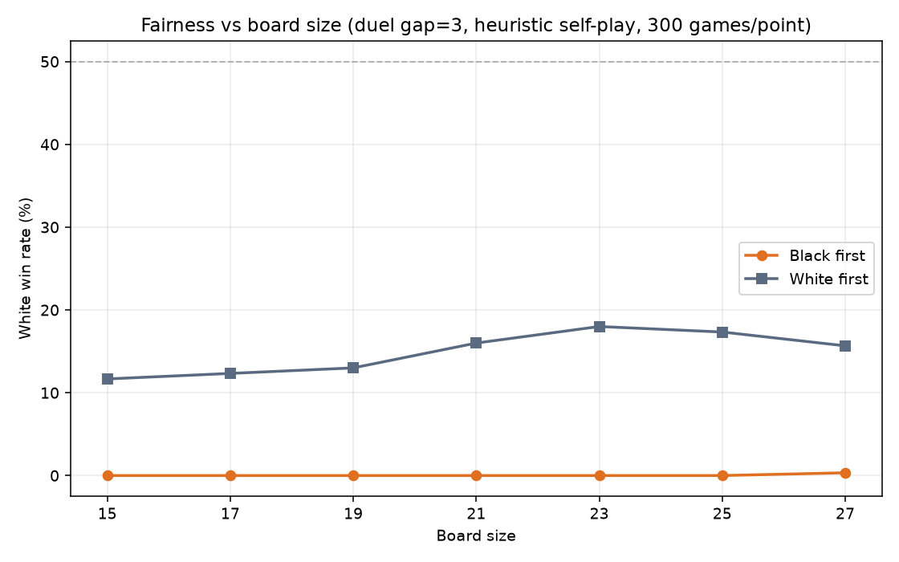
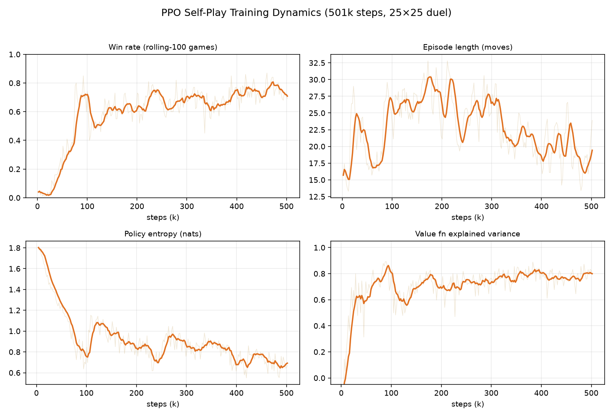

# Terraflux: A Board Game Where the Board Plays Back

**Preliminary findings, revised after replication (v2)**

*AJiTai · August 2026 (v2 revision: October 2026)*
*Code: [github.com/ajt071220-netizen/terraflux](https://github.com/ajt071220-netizen/terraflux) · Playable demo: [ajt071220-netizen.github.io/terraflux](https://ajt071220-netizen.github.io/terraflux/) · Archive: [doi.org/10.5281/zenodo.16898141](https://doi.org/10.5281/zenodo.16898141)*

> **Revision note (v2) — please read first.** This version supersedes the August 2026 report (v1, kept as `REPORT_v1_superseded.md`). Two problems were found while preparing it.
>
> 1. **A bug in the training code.** The self-play environment hard-coded the per-move step penalty as −0.002 and ignored the `--step-penalty` setting. The "sparse" arm of the reward-shaping ablation therefore received the same reward as the "shaped" arm. Every conclusion built on that comparison is withdrawn: the "24% slower" result, the "logs lie" conclusion, and the 66%:14.5% head-to-head in Table 3 and Figure 3 of v1. The bug was fixed in `python/train_ppo.py`, and the sparse runs were repeated with the fix.
> 2. **Run-to-run variation is larger than the effects we claimed.** Training runs that share the same reward configuration differ widely in their White win rate on the duel layout (9% to 84%). The "strength ladder" of 0% → 20% → 34% → 46% in v1 was built from individual runs, and it does not survive replication. An identical-configuration pair reproduces the 66%:21% head-to-head pattern that v1 attributed to reward shaping.
>
> The v1 claims are therefore mostly **weakened or withdrawn**. What remains is listed in the Summary of Findings below.

## Abstract

I designed Terraflux, an asymmetric board game in which the board itself takes part in the play, alongside the pieces. Its three departures from tradition are a fluid terrain that is rewritten by every move, a terrain-owned height rule, and asymmetric pursuit-evasion goals. To study these designs, I trained a self-play PPO agent as a referee and ran twenty-nine training runs under three reward and terrain configurations; twenty-six of the twenty-nine have recorded seeds. Evaluation used duel self-play (300 games per run, all twenty-nine runs) and round-robin matches among the thirteen dynamic-terrain runs (78 pairs, 100 games per colour per pair). The replicates support three narrow findings. First, training on this game is noisy: rolling win rates in the second half of training oscillate in every dynamic-terrain run, and the value function's explained variance plateaus well below one. A static-board control does not isolate the cause, because freezing the terrain changes the game's balance: in all six static runs Black wins no game. Second, the effect of a per-move step penalty on learning speed is not distinguishable from run-to-run variation (ten sparse and thirteen penalised runs; permutation p ≈ 0.43 for speed and ≈ 0.34 for late-stage win rate). A late-stage difference seen with fewer runs did not survive the additional ones. Third, the balance of the duel layout cannot be certified from a single self-play policy: White's win rate ranges from 9% to 84% across runs with identical settings, and round-robin strength is only weakly related to it (Spearman ρ = 0.32 over the thirteen dynamic runs). The heuristic opponent remains the weakest reference, with White winning 0% of games. These findings are preliminary, and the study is not a basis for claims about balance or reward design.

**Keywords:** board games; self-play reinforcement learning; PPO; game balance; asymmetric games; replication; training-run variance.

## Summary of Findings (v2)

| v1 claim | Status in v2 | Evidence |
|---|---|---|
| The win rate never converges on a fluid board, and the value function never saturates. | **Partly supported.** Rolling win rate oscillates in every dynamic run (SD after 150k steps: 0.07–0.18). Explained variance plateaus at 0.57–0.77 after 150k steps. | Table 3; Figure 2. The static-board contrast is confounded (§4.2). |
| The oscillation is caused by terrain rewriting, and the opponent pool. | **Not established.** Static-board runs oscillate less (SD 0.05–0.12; p ≈ 0.007, uncorrected), which is consistent with a terrain effect, but the static game is degenerate, so the comparison cannot isolate a mechanism. | §4.2 |
| Sparse rewards are viable, but about 24% slower than shaped rewards. | **Withdrawn.** The comparison used identical rewards because of the bug. With the fix and ten sparse runs, the difference in speed is not significant (p ≈ 0.43). | §5 |
| Logged self-play win rates lie; a 66%:14.5% head-to-head reveals the truth. | **Withdrawn as a reward effect.** An identical-reward pair produced 66.0%:21.0%. The pattern is run-to-run variance. | §5.2 |
| Fairness rises monotonically with policy strength (0% → 20% → 34% → 46%). | **Not supported.** Replicates with identical settings span 9%–84%, and the correlation with round-robin strength is weak (ρ = 0.32). | §6 |
| Board size does not change fairness. | **Narrowed.** Tested only with the heuristic opponent, the weakest policy. | §2 |
| The duel layout (gap 3, Black first) is balanced at roughly 49:50. | **Withdrawn.** Not reproduced. The balance test behind this layout is not documented in the repository. | §6.3 |
| The reward design (±1 at game end) and the mirror-value design principle. | **Retained as design description.** The mirror-value principle is a design argument and has not been tested. | §7 |

## 1. Introduction — Boards That Don't Sit Still

In the overwhelming majority of board games played around the world today, the board is a silent actor. Moves may vary infinitely, but the stage itself never changes. What, then, if the board itself joined the play? With this thought, I designed Terraflux, a board game on which I set out to test three breaks from tradition.

Break one: every move rewrites the terrain around its landing cell — the board is no longer static. Break two: height belongs to the board, not the pieces; capture no longer relies on the traditional displacement of moving onto the opponent's cell, but on commanding height. Break three: the two sides' goals are no longer symmetric. White is a fugitive, fleeing toward a designated victory edge in the south; Black is the pursuer. On top of these come two alternating terrain phases governed by odd and even rounds, and a draw in which both sides satisfy their winning conditions at the same adjudication instant.

Each break raises questions that traditional board games rarely face. On a board without a stable state, what does a learned policy look like, and does training converge? When height decides victory and defeat, is a sparse terminal reward enough? For an asymmetric game, can anyone judge its fairness? I used a self-play PPO agent as a referee to explore these questions. v2 reports how the answers change when the experiments are replicated.

## 2. The Game in One Page

Terraflux is played on a 25×25 board of **pillars** — the standing columns whose heights the terrain continually rewrites. White starts from the northern half and wins by reaching the designated victory edge in the south; Black wins by capture — standing adjacent to White on a strictly higher pillar. Players alternate turns, with Black moving first by default. Every move rewrites the terrain around its landing cell: on odd-numbered rounds the cross phase fires (the pillar to the north rises, the one to the south sinks, and those to the east and west are filled solid, becoming impassable); on even-numbered rounds the X phase fires, raising and lowering pillars along the diagonals. Pillars cycle through three states — raised, lowered, filled — and filling is never final: a later phase can always reactivate a filled pillar. A third outcome is a draw, triggered when both sides satisfy their respective winning conditions at the same instant. The engine also ends games by threefold repetition and by a player having no legal move; training uses a 400-move cap (`maxMoves`), and the evaluation scripts stop at 800 plies. These rules are implemented in `python/engine.py`.

*Figure 1. Heuristic self-play only (300 games per point; duel, gap = 3). With Black moving first, White wins 0% of games at every board size. With White moving first, White's win rate stays between about 12% and 18%. Neither curve approaches 50%, so this scan shows only that board size does not change the outcome for this weak policy. It says nothing about fairness for stronger policies.*

**Table 1. Terraflux in the design space of classic abstract games**

| Dimension | Go / Chess | Zertz | Dvonn | **Terraflux** |
|---|---|---|---|---|
| Board | Static forever | Shrinks (tiles removed) | Static | **Rewritten by every move** |
| Height | — | — | Stacked pieces | **Terrain lifts the piece** |
| Objective | Symmetric | Symmetric | Symmetric | **Asymmetric (flee vs. hunt)** |
| Capture | Move onto piece | Jump over | Surround | **Adjacent + strictly higher** |

Table 1 compares Terraflux with four classic games. Labyrinth (Ravensburger), a tile-sliding maze game whose board changes every turn, and Quoridor, where walls are placed during play and change the paths, should be added to any comparison of boards that change during play. The novelty claim in v1 needs a fuller literature review before it can be made.

## 3. Manufacturing the Referee

A newly invented game has no human player community, so its fairness can only be estimated by manufacturing referees. I implemented the engine twice: a JavaScript version drives the Three.js 3D front end, and a Python port (`python/engine.py`) drives RL training. The two are meant to match rule for rule; I did not re-verify that cross-check in v2.

Training uses MaskablePPO with invalid-action masking. The observation is a 25×25×4 one-hot encoding of the terrain, plus both piece positions and eight metadata values. The action space is eight directions plus a pass. The reward is +1 for a win, −1 for a loss, and **0 for a draw**; a per-move step penalty of −0.002 is applied in the "shaped" configuration. The opponent pool mixes 65% heuristic play with 35% of the five most recent snapshots of the learner, and each run uses 500k steps on the 25×25 duel layout.

The duel layout is Black at the centre, White three rows due north, Black moving first, with a capture gap of 3. The code comments state that gap 3 was chosen as the most balanced option in an earlier test, reported as 49:50. That test is not documented in the repository, and the policy used is not specified, so the layout's balance cannot be treated as an independent result (see §6.3).

**Replicate protocol (v2).** Twenty-nine training runs were used:

- Three runs were trained before seeds were recorded (`main`, `abl_shaped`, `abl_sparse`). The `abl_sparse` run received the step-penalty bug described above, so its reward is identical to `abl_shaped`. It is therefore a same-configuration replicate.
- Seeded shaped runs (step penalty 0.002): seeds 2–11.
- Seeded sparse runs (no step penalty, bug fixed): seeds 1–10.
- Seeded static-board runs (terrain frozen, step penalty 0.002): seeds 1–6.

Evaluation has two parts. **Duel self-play**: each model plays 300 games against itself on the duel layout, with sampled actions, and I report White's win rate with a Wilson 95% interval. This was done for all twenty-nine runs. **Round robin**: the thirteen dynamic-terrain runs that were evaluated first played each other (78 pairs), 100 games per colour per pair (200 games per pair). The ten runs added in the last batch were evaluated by duel self-play only; they were not added to the round robin. Static-board models were not included in round robin, since the default rules are the dynamic ones. Between-run comparisons use two-sided permutation tests with 10,000 shuffles, because the group sizes are small.

Sampling adds noise of its own. The same evaluation of one model (`abl_sparse`) gave 17.7% and 22.0% White win rates in two runs, a difference of about four percentage points.

## 4. Break I — The Board Plays Back

### 4.1 Training dynamics in dynamic-terrain runs

In play, a fluid board means there is no eternally safe position. What is safe today may collapse in three moves, and what is a dead end may reopen. The question is whether training can settle on such a board.

Figure 2 shows the main run, with the entropy axis now drawn as positive policy entropy. The rolling win rate rises quickly, then oscillates for the rest of training. The explained variance of the value function rises above 0.8 at about 150k steps and then stays around 0.75–0.8. The episode length also keeps changing. Table 2 gives the phase averages.

**Table 2. Training phases, main run (`training_log.jsonl`; phases by thirds of the log)**

| Phase | Steps | Rolling win rate | Policy entropy (nats) | Episode length |
|---|---|---|---|---|
| Early | 2k–165k | 0.419 | 1.119 | 23.1 |
| Mid | 167k–331k | 0.672 | 0.850 | 25.8 |
| Late | 333k–501k | 0.712 | 0.757 | 20.0 |

*The v1 table listed entropy as negative numbers. The training logs record SB3's `entropy_loss`, which is the negative of entropy; the signs above are corrected.*

*Figure 2. Training dynamics for the main run: rolling win rate (100-game window), episode length, policy entropy (nats, sign-corrected from SB3's entropy loss), and value-function explained variance.*

Across the twenty-nine runs, the picture is consistent but variable (Table 3). After 150k steps, the rolling win rate has standard deviation 0.07–0.18 in every dynamic-terrain run. Explained variance averages 0.57–0.77 in the dynamic runs. The number of entropy jumps larger than 0.25 between samples ranges from 0 to 5, and the number of KL spikes above 0.15 ranges from 0 to 6. The v1 "fingerprint" of two entropy jumps at 94k and 104k was a single run's pattern, not a stable signature.

### 4.2 Is the oscillation caused by the terrain?

To test whether the terrain causes the oscillation, I froze it. The static-board runs use the same reward, pool, and training length, with the terrain frozen at its initial state. The static control is **not clean**, because freezing the terrain changes the game's balance (see §6.2). In all six static runs Black wins no duel self-play game. Four runs end with White winning 100% of 300 games, in about 30 moves; one run ends with 94% of games drawn by repetition; and one ends with 100% of games drawn. Those static policies are degenerate, so their learning curves are not comparable with the dynamic runs in any simple way.

With that caveat, the comparison against the thirteen shaped-configuration runs gives:

- **Win-rate oscillation** (SD after 150k): static 0.068 vs shaped-configuration 0.117, permutation p ≈ 0.007. This is consistent with the terrain driving the oscillation, but it is uncorrected for multiple comparisons, and the static game is so different that it cannot isolate a mechanism.
- **Explained variance** (mean after 150k): static 0.98 vs shaped-configuration 0.66, p < 0.001. This is what one would expect if the outcomes of the static game are almost deterministic, so it does not show that the terrain prevents saturation.
- **Entropy jumps** (1.8 vs 2.1; p ≈ 0.89) and **draw rates** (0.063 vs 0.111; p ≈ 0.09): no meaningful difference.

Conclusion for Break I: the training curves are noisy and vary from run to run, and the dynamic runs oscillate more than the static ones. That pattern is consistent with the terrain contributing to the oscillation, but the static control changes the game's balance, so the v1 claim that the terrain *causes* the non-convergence is **not established**. A proper test needs a static control that is balanced in its own right, or a different control, such as a terrain that changes slowly.

**Table 3. Training statistics per run (500k steps each; means over the stated window)**

| Run | Config | Steps to 55% (9-point smoothing) | Late win rate (≥333k) | Win-rate SD (≥150k) | Explained variance (≥150k) | Entropy jumps | KL spikes | Draw rate |
|---|---|---|---|---|---|---|---|---|
| main | shaped | 83k | 0.712 | 0.075 | 0.757 | 2 | 0 | 0.064 |
| abl_shaped | shaped | 59k | 0.719 | 0.080 | 0.708 | 3 | 1 | 0.061 |
| abl_sparse | shaped (bug) | 73k | 0.733 | 0.130 | 0.720 | 4 | 1 | 0.068 |
| shaped_s2 | shaped | 88k | 0.620 | 0.166 | 0.586 | 1 | 0 | 0.093 |
| shaped_s3 | shaped | 77k | 0.697 | 0.115 | 0.694 | 3 | 5 | 0.107 |
| shaped_s4 | shaped | 180k | 0.721 | 0.111 | 0.648 | 5 | 6 | 0.166 |
| shaped_s5 | shaped | 61k | 0.684 | 0.076 | 0.669 | 0 | 2 | 0.056 |
| shaped_s6 | shaped | 75k | 0.620 | 0.111 | 0.653 | 0 | 0 | 0.082 |
| shaped_s7 | shaped | 167k | 0.564 | 0.136 | 0.571 | 1 | 2 | 0.157 |
| shaped_s8 | shaped | 90k | 0.650 | 0.092 | 0.739 | 1 | 2 | 0.074 |
| shaped_s9 | shaped | 198k | 0.709 | 0.125 | 0.667 | 2 | 0 | 0.284 |
| shaped_s10 | shaped | 143k | 0.600 | 0.127 | 0.619 | 1 | 2 | 0.100 |
| shaped_s11 | shaped | 59k | 0.600 | 0.184 | 0.531 | 4 | 3 | 0.136 |
| sparse_s1 | sparse | 182k | 0.617 | 0.119 | 0.651 | 1 | 1 | 0.153 |
| sparse_s2 | sparse | 77k | 0.599 | 0.098 | 0.653 | 2 | 0 | 0.099 |
| sparse_s3 | sparse | 67k | 0.582 | 0.178 | 0.583 | 1 | 2 | 0.072 |
| sparse_s4 | sparse | 67k | 0.651 | 0.076 | 0.773 | 2 | 0 | 0.101 |
| sparse_s5 | sparse | 86k | 0.641 | 0.086 | 0.673 | 1 | 1 | 0.103 |
| sparse_s6 | sparse | 145k | 0.645 | 0.069 | 0.686 | 2 | 2 | 0.093 |
| sparse_s7 | sparse | 67k | 0.721 | 0.168 | 0.669 | 1 | 4 | 0.098 |
| sparse_s8 | sparse | 63k | 0.590 | 0.100 | 0.644 | 0 | 3 | 0.062 |
| sparse_s9 | sparse | 227k | 0.769 | 0.134 | 0.689 | 2 | 3 | 0.206 |
| sparse_s10 | sparse | 270k | 0.581 | 0.129 | 0.583 | 0 | 3 | 0.110 |
| static_s1 | static | not reached | 0.461 | 0.093 | 0.985 | 2 | 2 | 0.041 |
| static_s2 | static | not reached | 0.502 | 0.048 | 0.979 | 0 | 2 | 0.068 |
| static_s3 | static | not reached | 0.499 | 0.048 | 0.958 | 3 | 3 | 0.088 |
| static_s4 | static | not reached | 0.500 | 0.048 | 0.994 | 5 | 1 | 0.020 |
| static_s5 | static | 192k | 0.503 | 0.050 | 0.966 | 0 | 1 | 0.113 |
| static_s6 | static | not reached | 0.456 | 0.119 | 0.987 | 1 | 2 | 0.048 |

*"Late win rate" is the mean over steps ≥333k. "Steps to 55%" uses the 9-point rolling mean of logged win rates; most static runs never held 55% under this smoothing (static_s5 reached it at 192k). Figure 3(c) plots the explained-variance and win-rate SD columns for all runs.*

## 5. Break II — Reward Shaping and the Step Penalty

### 5.1 The v1 comparison is withdrawn

v1 compared a shaped arm (step penalty −0.002) with a sparse arm (no step penalty) and reported that sparse training was about 24% slower to reach 55%, that the two arms' logged win rates looked tied at the end, and that the shaped arm won head-to-head 66.0%:14.5%. All of these results come from the bug described at the top of this report: the sparse arm was trained with the step penalty. The timing and late-window numbers in v1 reproduce exactly from the original logs (`python/analyze_ablation.py`), which confirms that they describe the logs but not the reward. The v1 head-to-head figure was not re-derived from the logs; it is reproduced in §5.2 by a placebo pair. Because the two arms had the same reward, these numbers measure run-to-run variance and nothing about the step penalty.

### 5.2 A placebo that reproduces the v1 result

The head-to-head result in v1 is reproduced by two runs with identical rewards. In the round robin of v2, `abl_shaped` beat `abl_sparse` 66.0% to 21.0%, with 13.0% draws. This is close to v1's 66.0% to 14.5%. Two runs with the same configuration produced the same pattern that v1 attributed to reward shaping.

### 5.3 What the corrected comparison shows

With the bug fixed, I ran ten true sparse runs (seeds 1–10) and compared them with the thirteen shaped-configuration runs:

- **Steps to 55%:** sparse 126k (mean of ten) vs shaped-configuration 105k (mean of thirteen). Difference +21k, permutation p ≈ 0.43. Not significant.
- **Late win rate (≥333k):** sparse 0.639 vs shaped-configuration 0.664. Difference −0.024, permutation p ≈ 0.34. Not significant.
- **Round-robin spread:** the mean absolute deviation of pairwise win rates from 50% is 13.4 points for pairs with identical rewards (n = 21) and 13.3 points for shaped-versus-sparse pairs (n = 42), among the thirteen round-robin runs. The reward setting adds nothing visible beyond run-to-run variation in this measure.

An earlier version of this analysis, with six sparse and seven shaped-configuration runs, found a late-stage difference (p ≈ 0.005). It did not survive the additional runs, which is a clear example of how fragile small-sample comparisons are. I do not conclude that the step penalty has no effect: these data show no detectable difference in learning speed or late-stage win rate, and the study is not powered to detect small effects. Answering the question more precisely would need a common opponent set for all runs.

## 6. Break III — Asymmetric Goals and Fairness

### 6.1 The heuristic is the weakest reference

The heuristic opponent, playing against itself on the duel layout with Black moving first, lets White win 0% of games (300 games, re-run for v2: 0.0%, 95% CI 0.0–1.3%; Black won all games, in about 10 moves). The heuristic's White evaluation contains a "keep distance" term, but its weight is overwhelmed by a term that rushes toward the edge. White therefore cannot escape at all. This is a property of this weak policy, not evidence about the layout's fairness.

### 6.2 Fairness varies with the training run

Duel self-play White win rates (300 games per run; Wilson 95% intervals) for all twenty-nine runs are plotted in Figure 3(a), and listed here:

- **shaped-configuration runs:** main 46.3%; abl_shaped 32.7%; abl_sparse (same reward as shaped) 22.0%; shaped_s2 26.3%; shaped_s3 **76.0%** [70.9, 80.5]; shaped_s4 41.7%; shaped_s5 47.0%; shaped_s6 13.7%; shaped_s7 25.3%; shaped_s8 **84.0%** [79.4, 87.7]; shaped_s9 39.7%; shaped_s10 44.7%; shaped_s11 31.3%.
- **sparse runs:** sparse_s1 17.3%; sparse_s2 44.7%; sparse_s3 56.7%; sparse_s4 **8.7%** [6.0, 12.4]; sparse_s5 **62.7%** [57.1, 67.9]; sparse_s6 48.0%; sparse_s7 24.0%; sparse_s8 25.7%; sparse_s9 37.0%; sparse_s10 36.0%.
- **static-board runs:** static_s1 6.3% [4.1, 9.7] (93.7% of games drawn by repetition); static_s2–s5 100.0%; static_s6 0.0% (100% of games drawn by repetition). Black won no static game.

Runs with identical settings disagree by more than the effects v1 claimed. The dynamic-terrain runs range from 9% to 84% with identical rules, and the same policy evaluated twice moved by about four points. Duel self-play therefore cannot certify the layout's balance on its own: the answer depends on which training run is used. The static-board results show that the frozen terrain changes the game in a way that is not comparable with the dynamic one.

*Figure 3. Replicate study. (a) Duel self-play White win rate for each of the twenty-nine training runs, with 95% Wilson intervals; colour marks the configuration. (b) Round-robin win rates among the thirteen dynamic-terrain runs (row model's win rate against each column; draws excluded from the win rate, shown separately in the data file). (c) Training statistics per run: explained variance after 150k steps against the standard deviation of the rolling win rate after 150k steps.*

### 6.3 Strength and balance

Figure 3(b) gives the round-robin matrix. Averaged over its twelve opponents, each dynamic run's win rate is: sparse_s5 57.4%, sparse_s3 53.9%, sparse_s4 53.8%, abl_shaped 53.3%, shaped_s5 49.6%, sparse_s2 47.5%, shaped_s4 47.3%, sparse_s6 41.7%, main 39.0%, shaped_s3 35.5%, sparse_s1 35.5%, abl_sparse 30.2%, shaped_s2 29.3%. The ten runs added in the last batch are not in the round robin.

Two things follow. First, round-robin strength is only weakly related to White's win rate on the duel layout (Spearman ρ = 0.32 over the thirteen round-robin runs). An earlier draft reported 0.57 over eight runs; that value did not hold once more runs were added, so I do not claim any monotone relation. Second, the round robin is not transitive: of the 286 triples of runs, 21 (7%) form a cycle in which each beats the next. The v1 ranking (main first, shaped second, sparse third) was not stable: main ranks ninth of thirteen in v2.

The v1 claim that the duel layout is balanced at 49:50 is therefore **withdrawn**. The code comments report that gap 3 was chosen because it was the most balanced of the layouts tested, in a test that is not documented in the repository. Choosing a layout by its balance and then reporting that it is balanced is circular, and the replicates show that the balance estimate depends on the run used. A defensible balance claim would need the layout to be evaluated across many independent training runs and with several policy families, with draws reported alongside wins.

### 6.4 Draws

Draws are common, and they are excluded from every win rate above. In duel self-play, repetition is the main cause: static_s1 drew 281 of 300 games by repetition, and sparse_s2 drew 41 of 300 games in the same way (`experiments/replicate_eval.json`). In training, the draw rate averages 6–28% across dynamic runs and 2–11% across static runs. In round robin, draw rates range from about 2% to 40% for individual pairs. Any future fairness claim must report draws, and whether they are repetition draws or same-instant draws, because draws change the balance of the outcome even when the win rates look equal.

### 6.5 The same-instant draw

The same-instant draw is a draw in which both sides satisfy their winning conditions in one adjudication. It is designed as a rule feature, and v1 described it at length. The replicate runs were not used to measure how often it occurs, so v2 makes no claim about its frequency or balance.

## 7. Discussion — The Mirror-Value Test, Limitations, and Future Mechanisms

The mirror-value test is a design principle: in an asymmetric pursuit-evasion game, every element of the terrain vocabulary should be roughly symmetric in value between the fleeing side and the hunting side. Teleportation would benefit only the fugitive, and freezing would benefit only the pursuer, so both were excluded. Height and passability passed the principle. The principle has not been tested empirically in v2 and should be presented as a design argument.

The main limitations of v2 are these:

- **Modest samples for the between-group comparisons.** Ten sparse runs, thirteen shaped-configuration runs (including the bug-affected replicate), and six static runs. Most between-group comparisons are underpowered, and the permutation tests are two-sided and uncorrected.
- **Run-to-run variance dominates.** Several claims from v1 depended on single runs, and replicates show that their differences fall within run-to-run variation.
- **Degenerate static control.** Freezing the terrain changes the game's balance (Black wins no static game), so it is not a clean control for non-stationarity.
- **Pool-relative metrics.** Late-stage win rates are measured against each run's own snapshot pool, so they are not comparable across runs with different pools.
- **Weak-policy reference.** The heuristic is the only weak policy, and its 0% White win rate is specific to the heuristic.
- **Single layout, single evaluation distribution.** The study uses the duel layout only; the board-size scan used the heuristic only.
- **Round robin on thirteen dynamic runs only.** The ten runs added in the last batch were not added to the round robin, and static-board runs were evaluated by duel self-play, not against the other runs.
- **Reward bug in v1.** Results from the original ablation are invalid. The fix is in the code; the sparse arm was re-run ten times with the fix.

The next steps are concrete. Evaluate each run against a common set of policies, not only against its own pool. Add the late-batch runs to the round robin. Report draw types explicitly. Replace the static control with one that does not change the game's balance. Test the layout's balance across many runs before using it as a reference. Finally, reconsider the claim of a monotone relation between policy strength and fairness: with the current data it is not supported.

## 8. References and Links

- **Archived release (v1.0.0, citable DOI)**: [10.5281/zenodo.16898141](https://doi.org/10.5281/zenodo.16898141)
- **Code & full experiment data**: [github.com/ajt071220-netizen/terraflux](https://github.com/ajt071220-netizen/terraflux)
- **Playable 3D demo (bilingual, with narrated tutorial game)**: [ajt071220-netizen.github.io/terraflux](https://ajt071220-netizen.github.io/terraflux/)
- Browne, C., & Maire, F. (2010). Evolutionary game design. *IEEE Transactions on Computational Intelligence and AI in Games, 2*(1), 1–16. https://doi.org/10.1109/TCIAIG.2010.2041928 *(Added in v2; checked against the publisher listing.)*
- Heinrich, J., Lanctot, M., & Silver, D. (2015). Fictitious self-play in extensive-form games. *Proceedings of the 32nd International Conference on Machine Learning (ICML), PMLR 37*, 805–813. *(Added in v2; checked against the PMLR listing.)*
- Huang, S. & Ontañón, S. (2022). A Closer Look at Invalid Action Masking in Policy Gradient Algorithms. arXiv:2006.14171.
- Raffin, A. et al. (2021). Stable-Baselines3: Reliable Reinforcement Learning Implementations. *JMLR 22*(268).
- Schulman, J. et al. (2017). Proximal Policy Optimization Algorithms. arXiv:1707.06347.
- Vinyals, O. et al. (2019). Grandmaster level in StarCraft II using multi-agent reinforcement learning. *Nature, 575*(7782), 350–354. https://doi.org/10.1038/s41586-019-1724-z *(Added in v2; checked against the publisher listing.)*

## 9. Reproducibility

- Training: `python/train_ppo.py` (flags `--seed`, `--step-penalty`, `--static-terrain`, `--exp`). The batches are in `python/run_robustness.ps1` (first batch, `-Batch2`, and `-Batch3`). The evaluation pipelines are `python/run_batch2_pipeline.ps1` and `python/run_batch3_pipeline.ps1`.
- Training statistics: `python/analyze_robustness.py` → `experiments/robustness_training.json` (stdout in `experiments/robustness_stdout.txt`). Figure 2: `python/analyze_collapse.py`.
- Evaluation: `python/replicate_eval.py` (supports `--new-only`, `--shard`, `--skip-rr`, `--merge`) → `experiments/replicate_eval.json`. Heuristic baseline: `python/heuristic_duel.py` → `experiments/heuristic_duel.json`. Figure 3: `python/fig_replicates.py`.
- Figure 1: `python/scan_sizes.py` → `experiments/size_scan.json`, plotted by `experiments/fig_size_fairness.png`.
- Superseded (invalid) outputs are kept in `experiments/superseded/`: the v1 ablation figure (affected by the reward bug) and the v1 strength figure (hand-coded numbers).
- The v1 training logs for the original runs are unchanged. Their `abl_sparse` run is invalid as a reward comparison and is retained only as a same-configuration replicate.
