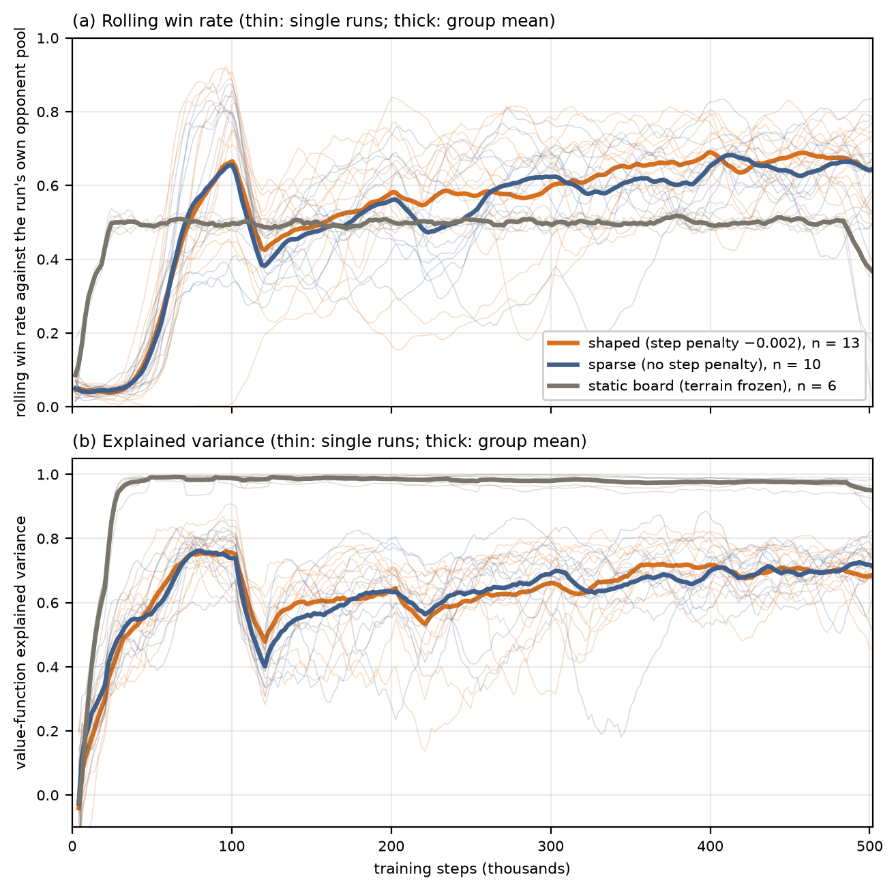
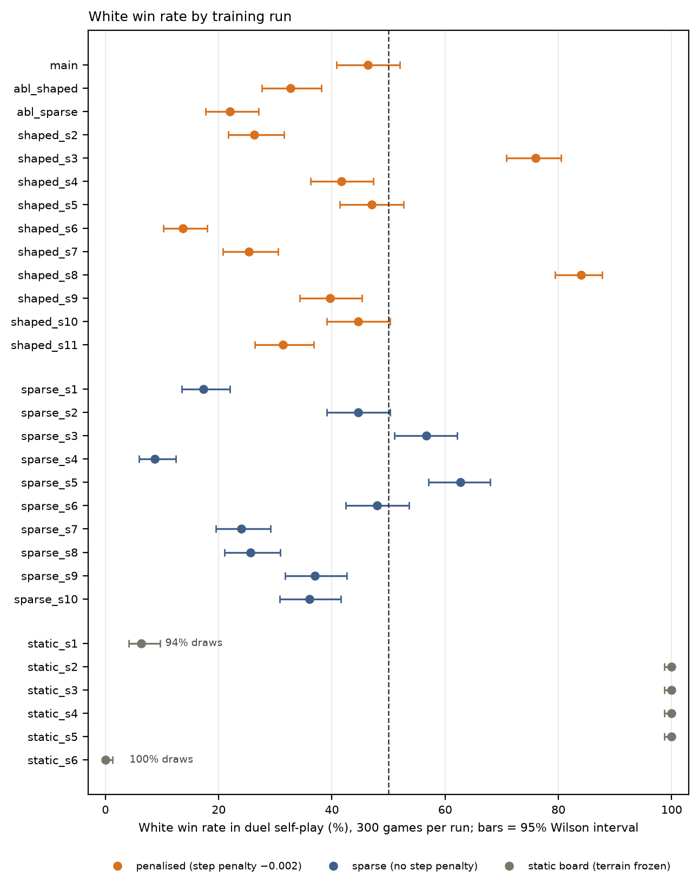
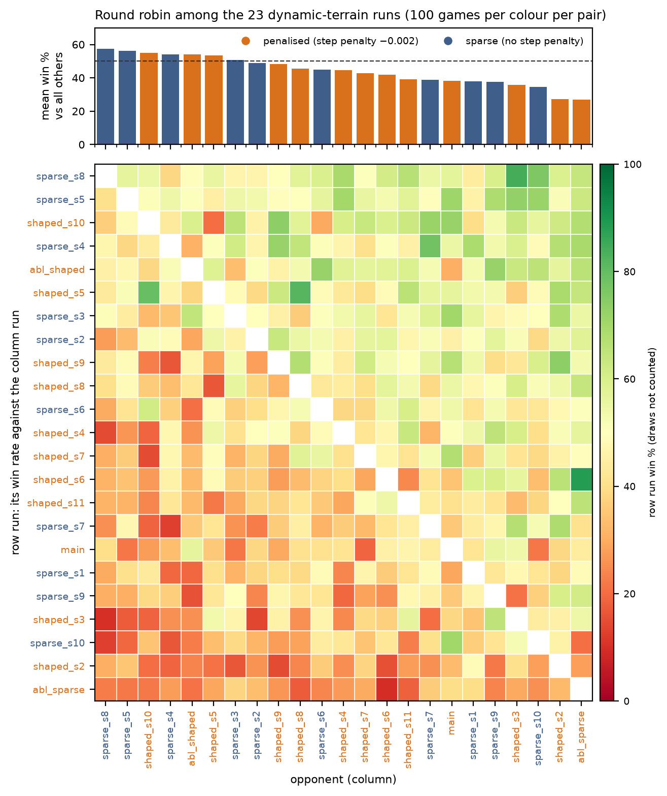

# Terraflux: A Board Game Where the Board Plays Back

**Preliminary findings, revised after replication (v2)**

*AJiTai · August 2026 (v2 revision: October 2026)*
*Code: [github.com/ajt071220-netizen/terraflux](https://github.com/ajt071220-netizen/terraflux) · Playable demo: [ajt071220-netizen.github.io/terraflux](https://ajt071220-netizen.github.io/terraflux/) · Archive: [doi.org/10.5281/zenodo.16898141](https://doi.org/10.5281/zenodo.16898141)*

> **Revision note (v2) — please read first.** This version supersedes the August 2026 report (v1, kept as `REPORT_v1_superseded.md`). Two problems were found while preparing it.
>
> 1. **A bug in the training code.** The self-play environment hard-coded the per-move step penalty as −0.002 and ignored the `--step-penalty` setting. The "sparse" arm of the reward-shaping ablation therefore received the same reward as the "shaped" arm. Every conclusion built on that comparison is withdrawn: the "24% slower" result, the "logs lie" conclusion, and the 66%:14.5% head-to-head in Table 3 and Figure 3 of v1. The bug was fixed in `python/train_ppo.py`, and the sparse runs were repeated with the fix.
> 2. **Run-to-run variation is larger than the effects we claimed.** Training runs that share the same reward configuration differ widely in their White win rate on the duel layout (9% to 84%). The "strength ladder" of 0% → 20% → 34% → 46% in v1 was built from individual runs, and it does not survive replication. An identical-configuration pair reproduces the 66%:21% head-to-head pattern that v1 attributed to reward shaping.
>
> The v1 claims are therefore mostly **weakened or withdrawn**. What remains is listed in the Summary of Findings below.

## Abstract

I designed Terraflux, an asymmetric board game in which the board itself takes part in the play, alongside the pieces. Its three departures from tradition are a fluid terrain that is rewritten by every move, a terrain-owned height rule, and asymmetric pursuit-evasion goals. To study these designs, I trained a self-play PPO agent as a referee and ran twenty-nine training runs under three reward and terrain configurations; twenty-six of the twenty-nine have recorded seeds. Evaluation used duel self-play (300 games per run, all twenty-nine runs) and round-robin matches among the twenty-three dynamic-terrain runs (253 pairs, 100 games per colour per pair). The replicates support three narrow findings. First, training on this game does not settle: rolling win rates in the second half of training oscillate in every dynamic-terrain run, and the value function's explained variance plateaus well below one. This holds in every dynamic run and is a characteristic of training on this game. A static-board control does not isolate the cause, because freezing the terrain changes the game's balance: in all six static runs Black wins no game. A separate twenty-run ablation of the opponent pool (last five snapshots vs all snapshots) leaves the oscillation unchanged (p = 0.50). Second, the effect of a per-move step penalty on learning speed is not distinguishable from run-to-run variation (ten sparse and thirteen penalised runs; permutation p ≈ 0.43 for speed and ≈ 0.34 for late-stage win rate). A late-stage difference seen with fewer runs did not survive the additional ones. Third, the balance of the duel layout cannot be certified from a single self-play policy: White's win rate ranges from 9% to 84% across runs with identical settings, and round-robin strength is only weakly related to it (Spearman ρ = 0.23 over the twenty-three dynamic runs). Cross-play across a population of twenty runs and the heuristic finds that the duel layout at its design gap of 3 favours White (71% of games), while heuristic self-play on the same layout gives White 0%; the gap that comes closest to 50% also depends on which policies play it. Balance in this game is therefore not a fixed property of the layout but depends on who plays it. These findings are preliminary, and the study is not a basis for general claims about balance or reward design.

**Keywords:** board games; self-play reinforcement learning; PPO; game balance; asymmetric games; replication; training-run variance.

## Summary of Findings (v2)

| v1 claim | Status in v2 | Evidence |
|---|---|---|
| The win rate never converges on a fluid board, and the value function never saturates. | **Partly supported.** Rolling win rate oscillates in every dynamic run (SD after 150k steps: 0.07–0.18). Explained variance plateaus at 0.57–0.77 after 150k steps. | Table 3; Figures 2 and 3. The static-board contrast is confounded (§4.2). |
| The oscillation is caused by terrain rewriting, and the opponent pool. | **Not established.** Static-board runs oscillate less (SD 0.05–0.12; p ≈ 0.007, uncorrected), which is consistent with a terrain effect, but the static game is degenerate and the largest swing in the dynamic runs coincides with the first snapshot entering the opponent pool (Figure 3), so the comparison cannot isolate a mechanism. Pool recency does not change the oscillation (SD 0.096 vs 0.088, p = 0.50; §4.3). | §4.2, §4.3 |
| Sparse rewards are viable, but about 24% slower than shaped rewards. | **Partly supported.** Sparse rewards are viable: all ten sparse runs with the bug fixed learned the game, reaching 55% about as fast as the penalised runs (126k vs 105k steps, p ≈ 0.43) and ending at a similar win rate (p ≈ 0.34). The "24% slower" result is withdrawn, because the v1 comparison used identical rewards. | §5 |
| Logged self-play win rates lie; a 66%:14.5% head-to-head reveals the truth. | **Withdrawn as a reward effect.** An identical-reward pair produced 66.0%:21.0%. The pattern is run-to-run variance. | §5.2 |
| Fairness rises monotonically with policy strength (0% → 20% → 34% → 46%). | **Monotone ladder not supported; underlying point supported.** Replicates with identical settings span 9%–84%, and the correlation with round-robin strength is weak (ρ = 0.23), so there is no monotone ladder. The underlying point, that balance is not a fixed property of the layout but depends on who plays it, is supported: at gap 3 White wins 0% under the heuristic and 71% in the trained population, and the two evaluators pick different gaps as the fairest. | §6, Table 5 |
| Board size does not change fairness. | **Narrowed.** Tested only with the heuristic opponent, the weakest policy. | §2 |
| The duel layout (gap 3, Black first) is balanced at roughly 49:50. | **Withdrawn.** The original balance test is not documented in the repository. Population cross-play finds that the layout favours White at gap 3 (71% of games; 95% CI 69%–74%). Gap 3 is kept as the game's design setting. | §6.3, Table 5 |
| The reward design (±1 at game end) and the mirror-value design principle. | **Retained as design description.** The mirror-value principle is a design argument and has not been tested. | §7 |

## 1. Introduction — Boards That Don't Sit Still

In the overwhelming majority of board games played around the world today, the board is a silent actor. Moves may vary infinitely, but the stage itself never changes. What, then, if the board itself joined the play? With this thought, I designed Terraflux, a board game on which I set out to test three breaks from tradition.

Break one: every move rewrites the terrain around its landing cell — the board is no longer static. Break two: height belongs to the board, not the pieces; capture no longer relies on the traditional displacement of moving onto the opponent's cell, but on commanding height. Break three: the two sides' goals are no longer symmetric. White is a fugitive, fleeing toward a designated victory edge in the south; Black is the pursuer. On top of these come two alternating terrain phases governed by odd and even rounds, and a draw in which both sides satisfy their winning conditions at the same adjudication instant.

Each break raises questions that traditional board games rarely face. On a board without a stable state, what does a learned policy look like, and does training converge? When height decides victory and defeat, is a sparse terminal reward enough? For an asymmetric game, can anyone judge its fairness? I used a self-play PPO agent as a referee to explore these questions. v2 reports how the answers change when the experiments are replicated.

## 2. The Game in One Page

Terraflux is played on a 25×25 board of **pillars** — the standing columns whose heights the terrain continually rewrites. White starts from the northern half and wins by reaching the designated victory edge in the south; Black wins by capture — standing adjacent to White on a strictly higher pillar. Players alternate turns, with Black moving first by default. Every move rewrites the terrain around its landing cell: on odd-numbered rounds the cross phase fires (the pillar to the north rises, the one to the south sinks, and those to the east and west are filled solid, becoming impassable); on even-numbered rounds the X phase fires, raising and lowering pillars along the diagonals. Pillars cycle through three states — raised, lowered, filled — and filling is never final: a later phase can always reactivate a filled pillar. A third outcome is a draw, triggered when both sides satisfy their respective winning conditions at the same instant. The engine also ends games by threefold repetition and by a player having no legal move; training uses a 400-move cap (`maxMoves`), and the evaluation scripts stop at 800 plies. These rules are implemented in `python/engine.py`.

*Figure 1. Heuristic self-play only (300 games per point; duel, gap = 3). With Black moving first, White wins 0% of games at every board size. With White moving first, White's win rate stays between about 12% and 18%. Neither curve approaches 50%, so this scan shows only that board size does not change the outcome for this weak policy. It says nothing about fairness for stronger policies.*

**Table 1. Terraflux in the design space of classic abstract games**

| Dimension | Go / Chess | Zertz | Dvonn | **Terraflux** |
|---|---|---|---|---|
| Board | Static forever | Shrinks (tiles removed) | Static | **Rewritten by every move** |
| Height | — | — | Stacked pieces | **Terrain lifts the piece** |
| Objective | Symmetric | Symmetric | Symmetric | **Asymmetric (flee vs. hunt)** |
| Capture | Move onto piece | Jump over | Surround | **Adjacent + strictly higher** |

Table 1 compares Terraflux with four classic games. Labyrinth (Ravensburger), a tile-sliding maze game whose board changes every turn, and Quoridor, where walls are placed during play and change the paths, should be added to any comparison of boards that change during play. The novelty claim in v1 needs a fuller literature review before it can be made.

## 3. Manufacturing the Referee

A newly invented game has no human player community, so its fairness can only be estimated by manufacturing referees. I implemented the engine twice: a JavaScript version drives the Three.js 3D front end, and a Python port (`python/engine.py`) drives RL training. The two are meant to match rule for rule; I did not re-verify that cross-check in v2.

Training uses MaskablePPO with invalid-action masking. The observation is a 25×25×4 one-hot encoding of the terrain, plus both piece positions and eight metadata values. The action space is eight directions plus a pass. The reward is +1 for a win, −1 for a loss, and **0 for a draw**; a per-move step penalty of −0.002 is applied in the "shaped" configuration. Once the learner has saved a snapshot, each training game draws its opponent from the heuristic with probability 0.5 and otherwise from the five most recent snapshots; before the first snapshot every opponent is the heuristic. This is the training script's default, which the seeded batches did not override (`python/run_robustness.ps1`). v1 described the mix as 65% heuristic and 35% snapshots; the ratio used for the three unseeded v1 runs was not recorded. Each run uses 500k steps on the 25×25 duel layout.

The duel layout is Black at the centre, White three rows due north, Black moving first, with a capture gap of 3. An earlier code comment stated that gap 3 was the most balanced option in a test reported as 49:50. That test is not documented in the repository, and the policy used is not specified, so the claim was withdrawn (see §6.3). The gap value itself is part of the game design and is unchanged.

**Replicate protocol (v2).** Twenty-nine training runs were used:

- Three runs were trained before seeds were recorded (`main`, `abl_shaped`, `abl_sparse`). The `abl_sparse` run received the step-penalty bug described above, so its reward is identical to `abl_shaped`. It is therefore a same-configuration replicate.
- Seeded shaped runs (step penalty 0.002): seeds 2–11.
- Seeded sparse runs (no step penalty, bug fixed): seeds 1–10.
- Seeded static-board runs (terrain frozen, step penalty 0.002): seeds 1–6.

A separate twenty-run opponent-pool ablation (§4.3) is not part of these twenty-nine runs.

Evaluation has two parts. **Duel self-play**: each model plays 300 games against itself on the duel layout, with sampled actions, and I report White's win rate with a Wilson 95% interval. This was done for all twenty-nine runs. **Round robin**: all twenty-three dynamic-terrain runs played each other (253 pairs), 100 games per colour per pair (200 games per pair). Static-board models were not included in round robin, since the default rules are the dynamic ones. Between-run comparisons use two-sided permutation tests with 10,000 shuffles, because the group sizes are small.

Sampling adds noise of its own. The same evaluation of one model (`abl_sparse`) gave 17.7% and 22.0% White win rates in two runs, a difference of about four percentage points.

## 4. Break I — The Board Plays Back

### 4.1 Training dynamics in dynamic-terrain runs

In play, a fluid board means there is no eternally safe position. What is safe today may collapse in three moves, and what is a dead end may reopen. The question is whether training can settle on such a board.

Figure 2 shows the main run, with the entropy axis now drawn as positive policy entropy. The rolling win rate rises quickly, then oscillates for the rest of training. The explained variance of the value function rises above 0.8 at about 150k steps and then stays around 0.75–0.8. The episode length also keeps changing. Table 2 gives the phase averages.

**Table 2. Training phases, main run (`training_log.jsonl`; phases by thirds of the log)**

| Phase | Steps | Rolling win rate | Policy entropy (nats) | Episode length |
|---|---|---|---|---|
| Early | 2k–165k | 0.419 | 1.119 | 23.1 |
| Mid | 167k–331k | 0.672 | 0.850 | 25.8 |
| Late | 333k–501k | 0.712 | 0.757 | 20.0 |

*The v1 table listed entropy as negative numbers. The training logs record SB3's `entropy_loss`, which is the negative of entropy; the signs above are corrected.*

*Figure 2. Training dynamics for the main run: rolling win rate (100-game window), episode length, policy entropy (nats, sign-corrected from SB3's entropy loss), and value-function explained variance.*

Across the twenty-nine runs, the picture is consistent but variable (Table 3). After 150k steps, the rolling win rate has standard deviation 0.07–0.18 in every dynamic-terrain run. Explained variance averages 0.57–0.77 in the dynamic runs. The number of entropy jumps larger than 0.25 between samples ranges from 0 to 5, and the number of KL spikes above 0.15 ranges from 0 to 6. The v1 "fingerprint" of two entropy jumps at 94k and 104k was a single run's pattern, not a stable signature.

### 4.2 Is the oscillation caused by the terrain?

To test whether the terrain causes the oscillation, I froze it. The static-board runs use the same reward, pool, and training length, with the terrain frozen at its initial state. The static control is **not clean**, because freezing the terrain changes the game's balance (see §6.2). In all six static runs Black wins no duel self-play game. Four runs end with White winning 100% of 300 games, in about 30 moves; one run ends with 94% of games drawn by repetition; and one ends with 100% of games drawn. Those static policies are degenerate, so their learning curves are not comparable with the dynamic runs in any simple way. This is also a finding about the game itself: without terrain rewriting, the duel layout is decided by colour, so the fluid terrain is what turns it into a contest.

With that caveat, the comparison against the thirteen shaped-configuration runs gives:

- **Win-rate oscillation** (SD after 150k): static 0.068 vs shaped-configuration 0.117, permutation p ≈ 0.007. This is consistent with the terrain driving the oscillation, but it is uncorrected for multiple comparisons, and the static game is so different that it cannot isolate a mechanism.
- **Explained variance** (mean after 150k): static 0.98 vs shaped-configuration 0.66, p < 0.001. This is what one would expect if the outcomes of the static game are almost deterministic, so it does not show that the terrain prevents saturation.
- **Entropy jumps** (1.8 vs 2.1; p ≈ 0.89) and **draw rates** (0.063 vs 0.111; p ≈ 0.09): no meaningful difference.

Conclusion for Break I: in every dynamic-terrain run the win rate keeps oscillating and does not settle, and the curves vary from run to run. The dynamic runs oscillate more than the static ones, but the largest swing in the dynamic runs coincides with the first snapshot entering the opponent pool (Figure 3), and the static curves are flat because their outcome is decided by colour. The comparison therefore cannot attribute the oscillation to the terrain, and the v1 claim that the terrain *causes* the non-convergence is **not established**. A proper test needs a static control that is balanced in its own right, or a different control, such as a terrain that changes slowly.

**Table 3. Training statistics per run (500k steps each; means over the stated window)**

| Run | Config | Steps to 55% (9-point smoothing) | Late win rate (≥333k) | Win-rate SD (≥150k) | Explained variance (≥150k) | Entropy jumps | KL spikes | Draw rate |
|---|---|---|---|---|---|---|---|---|
| main | shaped | 83k | 0.712 | 0.075 | 0.757 | 2 | 0 | 0.064 |
| abl_shaped | shaped | 59k | 0.719 | 0.080 | 0.708 | 3 | 1 | 0.061 |
| abl_sparse | shaped (bug) | 73k | 0.733 | 0.130 | 0.720 | 4 | 1 | 0.068 |
| shaped_s2 | shaped | 88k | 0.620 | 0.166 | 0.586 | 1 | 0 | 0.093 |
| shaped_s3 | shaped | 77k | 0.697 | 0.115 | 0.694 | 3 | 5 | 0.107 |
| shaped_s4 | shaped | 180k | 0.721 | 0.111 | 0.648 | 5 | 6 | 0.166 |
| shaped_s5 | shaped | 61k | 0.684 | 0.076 | 0.669 | 0 | 2 | 0.056 |
| shaped_s6 | shaped | 75k | 0.620 | 0.111 | 0.653 | 0 | 0 | 0.082 |
| shaped_s7 | shaped | 167k | 0.564 | 0.136 | 0.571 | 1 | 2 | 0.157 |
| shaped_s8 | shaped | 90k | 0.650 | 0.092 | 0.739 | 1 | 2 | 0.074 |
| shaped_s9 | shaped | 198k | 0.709 | 0.125 | 0.667 | 2 | 0 | 0.284 |
| shaped_s10 | shaped | 143k | 0.600 | 0.127 | 0.619 | 1 | 2 | 0.100 |
| shaped_s11 | shaped | 59k | 0.600 | 0.184 | 0.531 | 4 | 3 | 0.136 |
| sparse_s1 | sparse | 182k | 0.617 | 0.119 | 0.651 | 1 | 1 | 0.153 |
| sparse_s2 | sparse | 77k | 0.599 | 0.098 | 0.653 | 2 | 0 | 0.099 |
| sparse_s3 | sparse | 67k | 0.582 | 0.178 | 0.583 | 1 | 2 | 0.072 |
| sparse_s4 | sparse | 67k | 0.651 | 0.076 | 0.773 | 2 | 0 | 0.101 |
| sparse_s5 | sparse | 86k | 0.641 | 0.086 | 0.673 | 1 | 1 | 0.103 |
| sparse_s6 | sparse | 145k | 0.645 | 0.069 | 0.686 | 2 | 2 | 0.093 |
| sparse_s7 | sparse | 67k | 0.721 | 0.168 | 0.669 | 1 | 4 | 0.098 |
| sparse_s8 | sparse | 63k | 0.590 | 0.100 | 0.644 | 0 | 3 | 0.062 |
| sparse_s9 | sparse | 227k | 0.769 | 0.134 | 0.689 | 2 | 3 | 0.206 |
| sparse_s10 | sparse | 270k | 0.581 | 0.129 | 0.583 | 0 | 3 | 0.110 |
| static_s1 | static | not reached | 0.461 | 0.093 | 0.985 | 2 | 2 | 0.041 |
| static_s2 | static | not reached | 0.502 | 0.048 | 0.979 | 0 | 2 | 0.068 |
| static_s3 | static | not reached | 0.499 | 0.048 | 0.958 | 3 | 3 | 0.088 |
| static_s4 | static | not reached | 0.500 | 0.048 | 0.994 | 5 | 1 | 0.020 |
| static_s5 | static | 192k | 0.503 | 0.050 | 0.966 | 0 | 1 | 0.113 |
| static_s6 | static | not reached | 0.456 | 0.119 | 0.987 | 1 | 2 | 0.048 |

*"Late win rate" is the mean over steps ≥333k. "Steps to 55%" uses the 9-point rolling mean of logged win rates; most static runs never held 55% under this smoothing (static_s5 reached it at 192k). Figure 3 shows the corresponding training curves.*

*Figure 3. Training curves for all twenty-nine runs. (a) Rolling win rate (100-game window, then a 9-point rolling mean) against each run's own opponent pool. (b) Value-function explained variance (9-point rolling mean). Thin lines are single runs; thick lines are the mean over the runs in each configuration. Win rates are measured against each run's own pool, so their levels are not comparable across configurations.*

**What the curves show.** In every dynamic-terrain run the win rate climbs to a peak (about 0.65 for the group mean, up to about 0.9 for single runs) near 100k steps and then falls sharply at about 100–120k steps; explained variance falls at the same time. That is when the first snapshot of the learner enters the opponent pool: snapshots are saved every 100k steps, and before that every opponent is the heuristic. The largest swing in the curves is therefore shared by all dynamic runs and is at least partly produced by the training protocol, not by the terrain. Smaller dips follow the later snapshots (around 200–220k steps).

The static-board curves differ for a degenerate reason. In four of the static runs White wins every self-play game, and the learner's colour is assigned at random, so its win rate against the pool is 50% by construction. The value function can also read the outcome from the colour flag in its input, which is why its explained variance is close to 1. These curves therefore do not show that the static game is learned more stably; they show that its outcome is decided by colour.

### 4.3 Does the opponent pool drive the oscillation?

§4.2 notes that the largest swing in the dynamic runs coincides with the first snapshot entering the opponent pool. To test whether pool recency matters, I compared two pool rules over ten seeds each. Arm A samples the opponent from the most recent five snapshots; arm B samples from all snapshots (ten by the end of training). Both arms use the 25×25 duel layout (gap 3, Black first), 500k steps, step penalty −0.002, heuristic ratio 0.65, and a snapshot every 50k steps. The arms differ only in the pool rule. The heuristic ratio follows the v1 description; the seeded runs in Table 3 used 0.5 (§3), so the two arms are compared with each other, not with Table 3.

**Table 4. Pool rule comparison, seeds 1–10 (logged rows from 300k steps onward)**

| Arm | Pool | Late win rate (mean) | Within-run SD of win rate |
|---|---|---|---|
| A | last 5 snapshots | 0.620 | 0.096 |
| B | all snapshots | 0.657 | 0.088 |
| Paired difference (B − A) | | +0.037 (exact sign-flip p = 0.023) | −0.008 (p = 0.50) |

The late win rate is higher with all snapshots, but this is not a like-for-like comparison. Win rate is measured against each run's own pool, and the pool itself differs: older snapshots are probably weaker opponents, so the higher number may partly reflect an easier opponent rather than a stronger policy. I therefore do not read it as faster or better learning.

The oscillation is about the same under both rules (SD 0.096 vs 0.088, p = 0.50). Pool recency does not explain it: the oscillation persists when the pool is uniform over all snapshots. This matches the caution in §4.2 that the terrain has not been isolated as the cause. Persistent oscillation is therefore a stable characteristic of training on this game, but its cause remains open.

Two caveats apply. First, the first batch of this experiment gave identical results for both arms (late win rate 0.666 in each), because the runs produced at most five snapshots, so the two pool rules could not differ. That batch was discarded and rerun with snapshots every 50k steps. Second, an earlier arm with heuristic ratio 1.0 and 100k-step snapshots reached 0.802, but it differs from arm A in two settings, so it is not used for inference. The analysis script is `python/analyze_pool_ablation.py`.

## 5. Break II — Reward Shaping and the Step Penalty

### 5.1 The v1 comparison is withdrawn

v1 compared a shaped arm (step penalty −0.002) with a sparse arm (no step penalty) and reported that sparse training was about 24% slower to reach 55%, that the two arms' logged win rates looked tied at the end, and that the shaped arm won head-to-head 66.0%:14.5%. All of these results come from the bug described at the top of this report: the sparse arm was trained with the step penalty. The timing and late-window numbers in v1 reproduce exactly from the original logs (`python/analyze_ablation.py`), which confirms that they describe the logs but not the reward. The v1 head-to-head figure was not re-derived from the logs; it is reproduced in §5.2 by a placebo pair. Because the two arms had the same reward, these numbers measure run-to-run variance and nothing about the step penalty.

### 5.2 A placebo that reproduces the v1 result

The head-to-head result in v1 is reproduced by two runs with identical rewards. In the round robin of v2, `abl_shaped` beat `abl_sparse` 66.0% to 21.0%, with 13.0% draws. This is close to v1's 66.0% to 14.5%. Two runs with the same configuration produced the same pattern that v1 attributed to reward shaping.

### 5.3 What the corrected comparison shows

With the bug fixed, I ran ten true sparse runs (seeds 1–10) and compared them with the thirteen shaped-configuration runs:

- **Steps to 55%:** sparse 126k (mean of ten) vs shaped-configuration 105k (mean of thirteen). Difference +21k, permutation p ≈ 0.43. Not significant.
- **Late win rate (≥333k):** sparse 0.639 vs shaped-configuration 0.664. Difference −0.024, permutation p ≈ 0.34. Not significant.
- **Round-robin spread:** among all twenty-three dynamic runs, the mean absolute deviation of pairwise win rates from 50% is 15.1 points for pairs with identical rewards (n = 78) and 12.6 points for shaped-versus-sparse pairs (n = 130). The direction is the reverse of what an earlier estimate on thirteen runs showed (13.4 vs 13.3), so this measure does not show a reward effect in either direction; it is dominated by run-to-run variation.

This answers the question v1 posed: a sparse terminal reward is enough to learn this game. All ten sparse runs reached a 55% rolling win rate within 500k steps (between 63k and 270k steps; Table 3).

An earlier version of this analysis, with six sparse and seven shaped-configuration runs, found a late-stage difference (p ≈ 0.005). It did not survive the additional runs, which is a clear example of how fragile small-sample comparisons are. I do not conclude that the step penalty has no effect: these data show no detectable difference in learning speed or late-stage win rate, and the study is not powered to detect small effects. Answering the question more precisely would need a common opponent set for all runs.

## 6. Break III — Asymmetric Goals and Fairness

### 6.1 The heuristic is the weakest reference

The heuristic opponent, playing against itself on the duel layout with Black moving first, lets White win 0% of games (300 games, re-run for v2: 0.0%, 95% CI 0.0–1.3%; Black won all games, in about 10 moves). The heuristic's White evaluation contains a "keep distance" term, but its weight is overwhelmed by a term that rushes toward the edge. White therefore cannot escape at all. This is a property of this weak policy, not evidence about the layout's fairness.

### 6.2 Fairness varies with the training run

Duel self-play White win rates (300 games per run; Wilson 95% intervals) for all twenty-nine runs are plotted in Figure 4, and listed here:

- **shaped-configuration runs:** main 46.3%; abl_shaped 32.7%; abl_sparse (same reward as shaped) 22.0%; shaped_s2 26.3%; shaped_s3 **76.0%** [70.9, 80.5]; shaped_s4 41.7%; shaped_s5 47.0%; shaped_s6 13.7%; shaped_s7 25.3%; shaped_s8 **84.0%** [79.4, 87.7]; shaped_s9 39.7%; shaped_s10 44.7%; shaped_s11 31.3%.
- **sparse runs:** sparse_s1 17.3%; sparse_s2 44.7%; sparse_s3 56.7%; sparse_s4 **8.7%** [6.0, 12.4]; sparse_s5 **62.7%** [57.1, 67.9]; sparse_s6 48.0%; sparse_s7 24.0%; sparse_s8 25.7%; sparse_s9 37.0%; sparse_s10 36.0%.
- **static-board runs:** static_s1 6.3% [4.1, 9.7] (93.7% of games drawn by repetition); static_s2–s5 100.0%; static_s6 0.0% (100% of games drawn by repetition). Black won no static game.

Runs with identical settings disagree by more than the effects v1 claimed. The dynamic-terrain runs range from 9% to 84% with identical rules, and the same policy evaluated twice moved by about four points. Duel self-play therefore cannot certify the layout's balance on its own: the answer depends on which training run is used. The static-board results show that the frozen terrain changes the game in a way that is not comparable with the dynamic one.

*Figure 4. White win rate in duel self-play for each of the twenty-nine training runs (300 games per run; bars are 95% Wilson intervals; the dashed line marks 50%). Colour marks the configuration. Static-board runs with a high draw rate are annotated with it. Runs with the same configuration differ by far more than their intervals.*

### 6.3 Strength and balance

Figure 5 gives the round-robin results over all twenty-three dynamic runs. Averaged over its twenty-two opponents, the win rates are: sparse_s8 57.3%, sparse_s5 56.1%, shaped_s10 55.0%, sparse_s4 54.1%, abl_shaped 53.9%, shaped_s5 53.4%, sparse_s3 50.8%, sparse_s2 48.9%, shaped_s9 48.2%, shaped_s8 45.6%, sparse_s6 44.8%, shaped_s4 44.5%, shaped_s7 42.8%, shaped_s6 42.0%, shaped_s11 39.0%, sparse_s7 38.8%, main 38.1%, sparse_s1 38.0%, sparse_s9 37.7%, shaped_s3 35.8%, sparse_s10 34.6%, shaped_s2 27.1%, abl_sparse 27.0%. The full values are in `experiments/roundrobin_summary.json`.

*Figure 5. Round robin among the twenty-three dynamic-terrain runs (100 games per colour per pair). Top: each run's mean win rate against the other twenty-two runs (draws are not counted as wins). Bottom: the win rate of the row run against the column run; runs are in the same order on both axes, and the per-pair numbers are in `experiments/replicate_eval.json`. Colour of the labels and bars marks the configuration.*

Two things follow. First, round-robin strength is only weakly related to White's win rate on the duel layout (Spearman ρ = 0.23 over twenty-three runs). Earlier estimates on thirteen runs (ρ = 0.32) and eight runs (ρ = 0.57) did not hold as the sample grew, so I do not claim any monotone relation. Second, the round robin is not transitive: of the 1,771 triples of runs, 181 (about 10%) form a cycle in which each beats the next. Cycles of this kind are consistent with the game supporting several distinct strategies that counter one another, rather than a single best line of play; the data do not show which strategies these are. The v1 ranking (main first, shaped second, sparse third) was not stable: main ranks eighteenth of twenty-three in v2.

The v1 claim that the duel layout is balanced at 49:50 is therefore **withdrawn**. A population-based evaluation (`experiments/fairness_pop_gap3.json`; the twenty seeded dynamic-terrain runs, shaped_s2–s11 and sparse_s1–s10, plus the heuristic, cross-played in both colours) finds that White wins 71% of games at gap 3 (95% CI 69%–74%), so the layout favours White. Model actions are sampled, so these games cannot be replayed exactly; an independent second sample with the same design (`experiments/draw_types_pop_gap3.json`) gave 70%, with model-versus-model 0.716, against the heuristic 0.588 and self-play 0.403, all inside the intervals reported here. The gap value is kept unchanged: it is part of the game design, and an asymmetric game need not give the two sides equal chances at every setting. An earlier code comment reported that gap 3 was chosen because it was the most balanced of the layouts tested, in a test that is not documented in the repository. Choosing a layout by its balance and then reporting that it is balanced is circular, and the replicates show that the balance estimate depends on the run used. The population cross-play below is a step toward a defensible balance claim; a fuller one would also need policies trained at each gap, more than one policy family, and draws reported alongside wins.

The two fairness measurements answer different questions, so they do not contradict each other. Duel self-play (§6.2) pits each policy against itself, so White and Black share the same strengths and weaknesses. In population cross-play, White and Black are played by different policies. For the same twenty seeded runs at gap 3, self-play gives a mean White win rate of 0.395 (95% CI 0.318–0.473; 20 games per run), while cross-play between models gives 0.727 (0.703–0.750) and play against the heuristic gives 0.593 (0.525–0.655) (`experiments/fairness_pop_gap3.json`). One reading is that, in this game, the pursuer's play depends more on knowing its opponent than the fugitive's does; this interpretation was not tested directly.

To check whether gap 3 is the exception or the norm, I evaluated all gaps from 1 to 8 with two evaluators. The trained population is the same twenty seeded runs and the heuristic, cross-played in both colours (210 pairings, 10 games per colour each), summarised by the mean White win rate over pairings with a cluster bootstrap interval. The heuristic column is 300 self-play games per gap with Black moving first (Wilson intervals).

**Table 5. White win rate by gap (duel layout, Black first)**

| Gap | Trained population, mean White win rate (95% CI) | Heuristic self-play, White win rate (95% CI) |
|---|---|---|
| 1 | 0.508 (0.484–0.533) | 0.0% (0.0–1.3) |
| 2 | 0.543 (0.519–0.566) | 0.3% (0.1–1.9) |
| **3 (game setting)** | **0.714 (0.691–0.736)** | 0.0% (0.0–1.3) |
| 4 | 0.591 (0.568–0.615) | 8.0% (5.4–11.6) |
| 5 | 0.616 (0.595–0.638) | 3.3% (1.8–6.0) |
| 6 | 0.550 (0.528–0.571) | 68.7% (63.2–73.7) |
| 7 | 0.540 (0.516–0.565) | 18.7% (14.7–23.5) |
| 8 | 0.520 (0.497–0.543) | 64.3% (58.8–69.5) |

Using each evaluator's own criterion (closest to 50%), the heuristic selects gap 8 and the trained population selects gap 1. Neither selects gap 3. The two evaluators also disagree about which gaps are fair, so the balance of a layout depends on the policies that play it. Gap 3 is kept as the game's setting, as stated above; this table shows only how it compares with the alternatives. One caveat applies to the trained column: every model was trained at gap 3 only, so its results at other gaps measure how well the policies transfer to an unfamiliar gap, not only the balance of that gap.

### 6.4 Draws

Draws are common, and they are excluded from every win rate above. In duel self-play, repetition is the main cause: static_s1 drew 281 of 300 games by repetition, and sparse_s2 drew 41 of 300 games in the same way (`experiments/replicate_eval.json`). In training, the draw rate averages 6–28% across dynamic runs and 2–11% across static runs. In round robin, draw rates range from 0% to 54% for individual pairs; some pairs are dominated by repetition draws, so their win rates should be read together with the draw rate. Any future fairness claim must report draws, and whether they are repetition draws or same-instant draws, because draws change the balance of the outcome even when the win rates look equal.

### 6.5 The same-instant draw

The same-instant draw is a draw in which both sides satisfy their winning conditions in one adjudication: White reaches the goal edge on a cell where Black can capture it (`border-capture` in the engine). It is designed as a rule feature, and v1 described it at length.

It is rare but real. In duel self-play it ended 55 of the 6,900 games played by the twenty-three dynamic-terrain runs (0.8%), or 12% of their draws (55 of 473; repetition accounts for 364 and the move cap for 54). It appeared in 14 of the 23 runs, at most 8 of 300 games in any one run. It never occurred in the 1,800 static-board games, where every draw was by repetition. In population cross-play at gap 3 it ended 3 of 3,800 model-versus-model games (0.08%), none of the 400 games against the heuristic, and 5 of 400 self-play games (1.3%) (`experiments/draw_types_pop_gap3.json`). In these data, then, the same-instant draw occurs only on the fluid board, and mostly when a policy meets itself. These counts describe how often it occurs; they do not show which side it favours.

## 7. Discussion — The Mirror-Value Test, Limitations, and Future Mechanisms

The mirror-value test is a design principle: in an asymmetric pursuit-evasion game, every element of the terrain vocabulary should be roughly symmetric in value between the fleeing side and the hunting side. Teleportation would benefit only the fugitive, and freezing would benefit only the pursuer, so both were excluded. Height and passability passed the principle. The principle has not been tested empirically in v2 and should be presented as a design argument.

The main limitations of v2 are these:

- **Modest samples for the between-group comparisons.** Ten sparse runs, thirteen shaped-configuration runs (including the bug-affected replicate), and six static runs. Most between-group comparisons are underpowered, and the permutation tests are two-sided and uncorrected.
- **Run-to-run variance dominates.** Several claims from v1 depended on single runs, and replicates show that their differences fall within run-to-run variation.
- **Degenerate static control.** Freezing the terrain changes the game's balance (Black wins no static game), so it is not a clean control for non-stationarity.
- **Pool-relative metrics.** Late-stage win rates are measured against each run's own snapshot pool, so they are not comparable across runs with different pools.
- **Weak-policy reference.** The heuristic is the only weak policy, and its 0% White win rate is specific to the heuristic.
- **Single layout, single training gap.** The study uses the duel layout only, and every model was trained at gap 3; the other gaps in Table 5 were evaluated with these models, not with models trained on them. The board-size scan used the heuristic only.
- **Static runs outside the round robin.** Static-board runs were evaluated by duel self-play only, not against the dynamic runs.
- **Reward bug in v1.** Results from the original ablation are invalid. The fix is in the code; the sparse arm was re-run ten times with the fix.

The next steps are concrete. Extend the common-opponent evaluation of §6.3 to the training curves, so that runs are compared against the same opponents rather than their own pools. Report draw types explicitly. Replace the static control with one that does not change the game's balance. Train models at other gaps before drawing conclusions about those gaps. Finally, reconsider the claim of a monotone relation between policy strength and fairness: with the current data it is not supported.

## 8. References and Links

- **Archived release (v1.0.0, citable DOI)**: [10.5281/zenodo.16898141](https://doi.org/10.5281/zenodo.16898141)
- **Code & full experiment data**: [github.com/ajt071220-netizen/terraflux](https://github.com/ajt071220-netizen/terraflux)
- **Playable 3D demo (bilingual, with narrated tutorial game)**: [ajt071220-netizen.github.io/terraflux](https://ajt071220-netizen.github.io/terraflux/)
- Browne, C., & Maire, F. (2010). Evolutionary game design. *IEEE Transactions on Computational Intelligence and AI in Games, 2*(1), 1–16. https://doi.org/10.1109/TCIAIG.2010.2041928 *(Added in v2; checked against the publisher listing.)*
- Heinrich, J., Lanctot, M., & Silver, D. (2015). Fictitious self-play in extensive-form games. *Proceedings of the 32nd International Conference on Machine Learning (ICML), PMLR 37*, 805–813. *(Added in v2; checked against the PMLR listing.)*
- Huang, S. & Ontañón, S. (2022). A Closer Look at Invalid Action Masking in Policy Gradient Algorithms. arXiv:2006.14171.
- Raffin, A. et al. (2021). Stable-Baselines3: Reliable Reinforcement Learning Implementations. *JMLR 22*(268).
- Schulman, J. et al. (2017). Proximal Policy Optimization Algorithms. arXiv:1707.06347.
- Vinyals, O. et al. (2019). Grandmaster level in StarCraft II using multi-agent reinforcement learning. *Nature, 575*(7782), 350–354. https://doi.org/10.1038/s41586-019-1724-z *(Added in v2; checked against the publisher listing.)*

## 9. Reproducibility

- Training: `python/train_ppo.py` (flags `--seed`, `--step-penalty`, `--static-terrain`, `--pool-window`, `--snapshot-every`, `--heuristic-ratio`, `--exp`). The batches are in `python/run_robustness.ps1` (first batch, `-Batch2`, and `-Batch3`). The evaluation pipelines are `python/run_batch2_pipeline.ps1` and `python/run_batch3_pipeline.ps1`.
- Training statistics: `python/analyze_robustness.py` → `experiments/robustness_training.json` (stdout in `experiments/robustness_stdout.txt`). Figure 2: `python/analyze_collapse.py`.
- Round robin: `python/run_rr_pipeline.ps1` (extends the round robin to all dynamic runs, sharded) and `python/analyze_roundrobin.py` → `experiments/roundrobin_summary.json`.
- Evaluation: `python/replicate_eval.py` (supports `--new-only`, `--shard`, `--skip-rr`, `--merge`) → `experiments/replicate_eval.json`. Heuristic baseline: `python/heuristic_duel.py` → `experiments/heuristic_duel.json`. Figures 3–5: `python/fig_replicates.py`.
- Figure 1: `python/scan_sizes.py` → `experiments/size_scan.json`, plotted by `experiments/fig_size_fairness.png`.
- Layout balance (§6.3): `python/scan_gap.py` (heuristic gap scan, 300 games per gap) → `experiments/gap_scan.json`; `python/fairness_pop.py <games_per_colour> <gaps>` (population cross-play, one JSON per gap) → `experiments/fairness_pop_gap{1..8}.json`.
- Same-instant draws (§6.5): duel self-play draw reasons are in `experiments/replicate_eval.json` (`draw_reasons`); population cross-play end reasons at gap 3: `python/draw_types_pop.py` → `experiments/draw_types_pop_gap3.json`.
- Opponent-pool ablation (§4.3): `python/run_ablation2.ps1` (training, arms A and B, seeds 1–10) → `python/training_log_abl2_{A,B}_s{1..10}.jsonl`; `python/analyze_pool_ablation.py` (Table 4).
- All numbers in this report are collected in `experiments/REPORT_DATA.md` (in Chinese; its v1 sections are kept for traceability and marked as superseded).
- Superseded (invalid) outputs are kept in `experiments/superseded/`: the v1 ablation figure (affected by the reward bug) and the v1 strength figure (hand-coded numbers).
- The v1 training logs for the original runs are unchanged. Their `abl_sparse` run is invalid as a reward comparison and is retained only as a same-configuration replicate.
